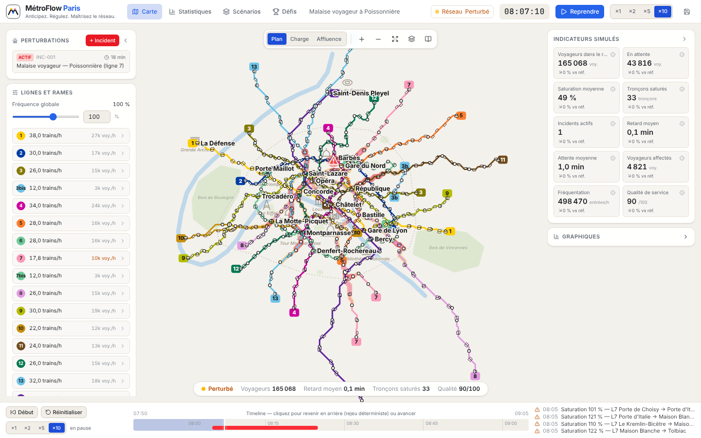

# MétroFlow Paris

**Anticipez. Régulez. Maîtrisez le réseau.**



Simulateur interactif de gestion du métro parisien : vous êtes au poste de supervision, vous déclenchez des incidents, observez la propagation des perturbations sur un plan schématique, puis régulez le réseau (fréquences, rames de réserve, fermetures) pour limiter retards et congestion.

> ⚠️ **Simulateur expérimental — pas un outil officiel de la RATP.** Les 16 lignes et leurs stations suivent le réseau réel (positions approximatives), mais la **demande de voyageurs est synthétique** : les flux, retards et indicateurs sont générés par le modèle et ne sont pas des mesures RATP ou Île-de-France Mobilités. Voir [`docs/DATA.md`](docs/DATA.md) et [`docs/MODEL.md`](docs/MODEL.md).

## Installation et lancement

Prérequis : Node.js ≥ 20.9.

```bash
npm install
npm run dev          # serveur de développement : http://localhost:3000
```

Version de production :

```bash
npm run build
npm start            # http://localhost:3000
```

Contrôles qualité :

```bash
npm test             # tests automatisés (Vitest)
npm run typecheck    # TypeScript strict
npm run validate:data  # contrôles de cohérence des données du réseau
```

Version autonome sans serveur (un dossier à ouvrir directement dans le navigateur) :

```bash
npm run build:standalone   # génère dist-standalone/index.html
```

Aucune API externe ni clé n'est nécessaire : une fois les dépendances installées, tout fonctionne hors ligne. Les sauvegardes sont stockées dans le navigateur (localStorage).

## Prise en main (2 minutes)

1. La carte s'ouvre sur le scénario « Malaise voyageur à Poissonnière ». Cliquez sur **Reprendre** (ou barre d'espace) et choisissez une vitesse (×1 = 1 minute simulée par seconde). Les **rames** circulent sur le plan ; leur partie blanche indique les places libres.
2. **Cliquez sur Poissonnière** (ligne 7, au nord de l'Opéra) : la carte de droite affiche la station. **Ajouter une perturbation** → « Malaise voyageur » → **Déclencher** (dans ce scénario, un malaise est de toute façon programmé à 8 h 05).
3. Observez : marqueur d'incident, rames ralenties sur la ligne 7, voyageurs qui s'accumulent sur les quais (points gris, anneau rouge si le quai sature), halos rouges sur les tronçons voisins, report vers la ligne 4.
4. Régulez dans **Lignes et rames** (panneau de gauche) : renforcez la fréquence et mobilisez des rames de réserve sur les lignes 7 et 4. Les indicateurs de droite se comparent en continu à la même partie « sans vos décisions ».
5. À la fin du scénario, le **bilan** donne votre score, les objectifs atteints et une médaille.

### Interactions avec la carte

| Action | Effet |
|---|---|
| Molette | zoom vers le pointeur |
| Glisser | déplacer la carte |
| Clic sur une station / un tronçon | panneau d'informations |
| Double-clic sur une station | centrer et zoomer |
| Boutons + / − / ⤢ | zoom, vue complète |
| Échap | fermer le formulaire, effacer l'itinéraire, désélectionner |
| Barre d'espace | pause / reprise |
| Timeline (bas) | cliquer pour revenir en arrière (rejeu déterministe) ou avancer |

Modes d'affichage : **Plan** (couleurs des lignes, halo rouge sur les tronçons chargés), **Charge** (couleur par saturation, voyageurs/h, retard ou variation vs référence), **Affluence** (heatmap autour des stations). Couches activables : fond de carte (Seine, bois, monuments), rames, voyageurs à quai, noms, numéros de ligne, correspondances, incidents, itinéraires, mini-carte, référence.

## Fonctionnalités

- **Plan épuré façon Mini Metro** des **16 lignes** — 321 stations, 391 tronçons, branches et correspondances — placé sur un fond de Paris simplifié (Seine, bois, périphérique, monuments-repères). **Rames animées** (canvas) dont le remplissage suit la charge simulée, voyageurs en attente sur les quais, zoom/déplacement (d3-zoom), étiquettes anti-collision.
- **Moteur de simulation** discret (pas de 10 s) : demande synthétique horaire reproductible (graine), affectation multi-itinéraires (Dijkstra + logit), capacités par sens, files d'attente, refus d'embarquement, recalcul des itinéraires après incident, résorption progressive.
- **10 types de perturbations** avec effets explicites et modifiables, gravité, durée, rayon, déclenchement immédiat ou programmé ; suspension, prolongation, changement de gravité, levée, historique. Marqueurs cliquables.
- **Régulation** : fréquence globale et par ligne (curseur + saisie), rames de réserve limitées, fermeture/réouverture de stations et de liaisons (avec confirmation), coût opérationnel fictif.
- **Tableau de bord** : 12 indicateurs avec unités, explications et écart à la référence ; graphiques de fréquentation, saturation par ligne, stations les plus chargées, retards/attentes, voyageurs affectés.
- **Mode expert** (Statistiques) : stations congestionnées, tronçons fragiles, lignes affectées, propagation, attentes, performance de chaque décision ; filtres par ligne, intervalle, type d'incident ; **comparaison A/B** (deux variantes lancées avec la même graine, ou parties enregistrées).
- **6 scénarios** (libre, heure de pointe, malaise à Poissonnière, Châtelet fermée, incidents multiples, pic d'affluence) et **5 défis** avec objectifs mesurables, difficulté, score sur 1000, médailles, bilan et progression sauvegardée.
- **Sauvegarde / reprise** (journal d'actions rejoué à l'identique), import/export JSON, export CSV des résultats, gestion des versions incompatibles.

## Architecture

```
src/
  app/                 routes Next.js (App Router) : / (carte), /statistiques, /scenarios, /defis
  components/
    layout/            AppShell, TopBar, BottomTimeline, MapDashboard (carte plein écran + panneaux flottants)
    map/               MetroMap, GeographyLayer, TrainLayer, MetroSegment, StationNode, IncidentMarker,
                       MapLegend, MapControls, MiniMap
    simulation/        IncidentForm, IncidentList, NetworkControls
    dashboard/         KPIGrid, charts, SelectionPanels, StatisticsScreen
    scenarios/         ScenarioSelector, ChallengePanel, ResultModal
    ui/                composants réutilisables
  data/                lignes, stations, correspondances, géographie (Seine, monuments), scénarios
  engine/              moteur pur TypeScript : graph, pathfinding, demandGenerator, passengerAssignment,
                       networkState, incidentManager, simulationEngine, scoring, defaults, rng
  lib/                 simulationController (pont UI ↔ worker), simCore + simulation.worker (moteur hors fil
                       d'affichage), persistence, export, metrics, comparison
  store/               Zustand : simulationStore, settingsStore, mapViewStore
  types/               network, incident, simulation, scenario
tests/                 Vitest
docs/                  DATA.md (sources, licences), MODEL.md (règles de calcul, limites)
```

Séparation stricte : le **moteur** (`src/engine`) ne dépend ni de React ni du navigateur ; les moteurs (partie du joueur et référence) tournent dans un **Web Worker** (`SimCore`), à une vitesse simulée indépendante du rendu ; le **contrôleur** (`src/lib/simulationController.ts`) lui transmet les commandes et publie ses instantanés dans le store à ~8 Hz (repli automatique dans le fil principal si le worker est indisponible). Toute modification passe par des **actions horodatées** (`engine.applyAction`) : c'est ce journal qui permet le rejeu, la timeline et les sauvegardes. Un backend Python/FastAPI pourrait remplacer le worker avec le même protocole (`simProtocol.ts`). La persistance passe par une interface `StorageBackend` (remplaçable par PostgreSQL/Supabase).

Stack : Next.js 16 (App Router, Turbopack), React 19, TypeScript strict, Tailwind CSS 4, Zustand, Recharts, Lucide, d3-zoom, Vitest.

## Tests

`npm test` couvre notamment : connexions du graphe et validation des données ; itinéraire entre deux stations ; impossibilité de traverser un tronçon fermé ; effet d'une fermeture de station ; création, suspension, prolongation et fin d'un incident ; cohérence des taux de saturation ; hausse de la congestion quand la demande dépasse la capacité ; retour progressif ; reproductibilité avec graine fixe ; rejeu du journal ; cohérence du score ; défis impossibles sans régulation et réalisables avec une stratégie de référence ; sauvegarde/rechargement et rejet des versions incompatibles.

## État d'avancement

Voir la fin de [`docs/MODEL.md`](docs/MODEL.md) pour les limites du modèle. Fonctionnalités non terminées :

- métro seul (pas de RER, tram ni bus) ;
- positions des stations et fond de carte approximatifs, saisis manuellement, non recoupés avec les données ouvertes RATP / IDFM ;
- les rames affichées sont une représentation du modèle macroscopique (débits), pas des trains suivis individuellement ;
- pas de linter configuré (TypeScript strict et tests seulement) ;
- interface optimisée pour ≥ 1440 × 900 ; utilisable mais dense sur petits écrans, pas de version mobile dédiée.

## Licence

Code sous licence MIT (voir `LICENSE`). Les éventuelles données ouvertes importées à l'avenir restent soumises à leur propre licence (voir `docs/DATA.md`).
